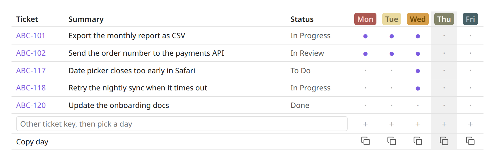

# Day Grid

A table at the top of your weekly note that lists your Jira tickets with one dot per weekday. Click a dot to log the ticket under that day, then copy a whole day's notes for your stand-up or timesheet.



*The grid for [`example.md`](example.md), a sample weekly note with made-up tickets.*

> Draft README.

## Prerequisites

- **Obsidian** 1.5 or later.
- **[Jira Issue](https://github.com/marc0l92/obsidian-jira-issue)** community plugin, installed, enabled and connected to your Jira account. Day Grid uses it to search Jira and to show `JIRA:ABC-123` links. Its inline issue prefix must be `JIRA:` (the default).

## Install

Copy `main.js`, `manifest.json` and `styles.css` into `<vault>/.obsidian/plugins/day-grid/`, then turn on **Day Grid** under Settings → Community plugins.

## Setup

**Settings → Day Grid**, shared by every note:

- **Jira query**: the JQL for the rows, for example:
  ```
  project = ABC AND assignee = currentUser() AND updated >= startOfWeek() AND updated <= endOfWeek() ORDER BY key
  ```
- **Limit**: the most tickets to load (default 40).
- **Jira account**: an account alias from the Jira Issue plugin. Leave it empty to use its default account.
- **Days**: the heading name for each weekday, in any language (`Mon`, `Pon`, `Monday`…). Leave a day empty to skip it. Monday to Friday are on by default.
- **Date after the name**: optional. A [moment.js format](https://momentjs.com/docs/#/displaying/format/) such as `DD.MM` makes new headings read `Thu 05.11`.

## Usage

Put an empty grid block in any note:

````
```day-grid
```
````

and click **Add days below**. The plugin writes this week's number into the block and a heading for each of your days under it:

````
```day-grid
week: 2026-W45
```

# Mon

- 

---
# Tue
…
````

- `week` sets the ISO week the grid covers. `startOfWeek()` and `endOfWeek()` in the query then mean that week's Monday 00:00 and Sunday 23:59, so old notes keep showing their own tickets. Without it, the grid follows the current week.
- `query`, `limit` and `account` can also go in the block. They override the shared settings for that grid only.
- A note can hold several weeks: each grid only reads the days between its block and the next `day-grid` block.

**Want the grid in every new weekly note?** Put the block in your own weekly template. With the core Templates or Daily notes plugin, `week: {{date:GGGG-[W]WW}}` fills in the week when the note is created. Or leave the block empty and click Add days below.

In the grid:

- **Empty dot**: adds `- JIRA:KEY` under that day's heading.
- **Filled dot**: jumps to the ticket's entry for that day.
- **Bottom row**: type a ticket key that isn't in the list, then click `+` under a day.
- **Copy day**: copies that day's notes, with each ticket line written as `- KEY: Summary`.

Rows follow the order of the query's results. Tickets you logged by hand that the query didn't return come last.

A day heading is a level-1 heading that starts with one of your day names: `# Thu`, `# thu`, `# Thu 05.11` and `# <mark class="thu">Thu</mark>` all count. The days can be in any order. A day ends at the next heading, a `---` line or a code fence. The plugin colors `<mark class="mon">` … `<mark class="sun">` by weekday, and today's column is highlighted when the grid shows the current week.

## Development

`node test.js` runs the self-checks for the note parsing, grid scopes, day names and week calculation.
