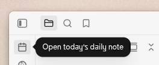

# Day Grid

A table at the top of your weekly note that lists your Jira tickets with one dot per weekday. Click a dot to log the ticket under that day, then copy a whole day's notes for your stand-up or timesheet.


*The grid for [`example.md`](example.md?plain=1), a sample weekly note with made-up tickets.*

> Draft README.

## Prerequisites

- **Obsidian** 1.5 or later.
- **[Jira Issue](https://github.com/marc0l92/obsidian-jira-issue)** community plugin, installed, enabled and connected to your Jira account. Day Grid uses it to search Jira and to show `JIRA:ABC-123` links. Its inline issue prefix must be `JIRA:` (the default).
- **Daily notes** core plugin, set up to make one note per week from a template (see below).

## Install

**With BRAT** (updates automatically):

1. Install the [BRAT plugin](obsidian://show-plugin?id=obsidian42-brat) ([web page](https://community.obsidian.md/plugins/obsidian42-brat)).
2. Go to **Settings → BRAT → Beta plugins** and click **Add beta plugin**.
3. Enter `MKrabs/obsidian-day-grid`, pick the latest version and click **Add plugin**. Day Grid shows up in the list.

**By hand:** download `main.js`, `manifest.json` and `styles.css` from the [latest release](https://github.com/MKrabs/obsidian-day-grid/releases/latest) into `<vault>/.obsidian/plugins/day-grid/`, then turn on **Day Grid** under Settings → Community plugins.

## Setup

### 1. Weekly notes

1. **Settings → Daily notes → Date format**: use one with a week in it, like `YYYY - [Week] WW - MMM` (gives `2026 - Week 45 - Nov`).
2. Create an empty note in any folder, for example `templates/Weekly.md`, and pick it as the **Template file location**.
3. **Settings → Day Grid → Copy template**, then paste it into that note. Write whatever you like above the grid or after the last day. Start the part after the last day with a heading or `---`, or it counts as part of that day.
4. Try it: click **Open today's daily note** in the ribbon, or run the command with the same name.

   

If you want, **Settings → Day Grid → Daily notes** checks the setup.

### 2. Settings → Day Grid

**Jira**

- **Query**: the JQL for the rows. The default lists your tickets updated that week, on any Jira:
  ```
  assignee = currentUser() AND updated >= startOfWeek() AND updated <= endOfWeek() ORDER BY key
  ```
  Narrow it as you like, for example with `project = ABC AND …`. ↺ brings the default back. Atlassian explains [how to write JQL](https://support.atlassian.com/jira-software-cloud/docs/use-advanced-search-with-jira-query-language-jql/) and the [JQL functions](https://support.atlassian.com/jira-software-cloud/docs/jql-functions/).

  If you'd like to copy my query, here it is. It also finds tickets where I'm the implementer, which is a custom field in our Jira:
  ```
  project = ABC AND (assignee = currentUser() OR Implementer = currentUser()) AND updated >= startOfWeek() AND updated <= endOfWeek() ORDER BY key
  ```
- **Account**: an account alias from the Jira Issue plugin. Leave it empty to use its default account, which the placeholder shows.

The grid loads as many tickets as the Jira Issue plugin's **Default search results limit** allows. Raise it there if tickets are missing.

**Days**

A day is a heading with a `<mark>` whose class is in this list. Each row has:

| Field | What it does | Default for Monday |
|---|---|---|
| Class | The `class` in `<mark class="…">` | `monday` |
| Title | The column name in the grid, and the text shown in an empty mark | `Mon` |
| Background, Text | The mark's colors, in your notes and in the grid | `#ab5852`, `#ffddd5` |

Monday to Friday come preset, with classes `monday` … `friday` and titles `Mon` … `Fri`. Change any field, remove a day, or add your own: other languages (`pon`), weekends, or anything else you want a column for. Each row shows a preview of the mark. **Copy template**, below the list, copies a Daily notes template with one empty-marked heading per day.

## Usage

- **Empty dot**: adds `- JIRA:KEY` under that day's heading.
- **Filled dot**: jumps to the ticket's entry for that day.
- **Bottom row**: type a ticket key that isn't in the list, then click `+` under a day.
- **Copy day**: copies that day's notes, with each ticket line written as `- KEY: Summary`.

Rows follow the order of the query's results. Tickets you logged by hand that the query didn't return come last.

### The grid block

- `week` sets the ISO week the grid covers. `startOfWeek()` and `endOfWeek()` in the query then mean that week's Monday 00:00 and Sunday 23:59, so old notes keep showing their own tickets. Without it, the grid follows the current week.
- `query`, `limit` and `account` can also go in the block. They override the settings for that grid only.

### Day headings

- Any heading level works, and the text inside or after the mark is up to you: `# <mark class="thursday">Donnerstag</mark> 05.11` is a Thursday column titled `Thu`.
- An empty mark, `<mark class="thursday"></mark>`, shows the day's title without it being written into the note. It must be truly empty: even a space inside shows nothing. The title is only displayed, so it isn't searchable and the Outline pane lists the heading as blank.
- Headings without a mark, or with a class that isn't in your list, are ignored. `# Notes` won't become a column.
- A day ends at the next heading, a `---` line or a code fence. Days can be in any order.
- Today's column is highlighted when the grid shows the current week and the day's class is a weekday name, in full or short (`monday` or `mon` … `sunday` or `sun`).
- A note can hold several weeks: each grid only reads the days between its block and the next `day-grid` block.

## Development

`node test.js` runs the self-checks for the note parsing, grid scopes, day list, colors, Daily notes check and week calculation.
